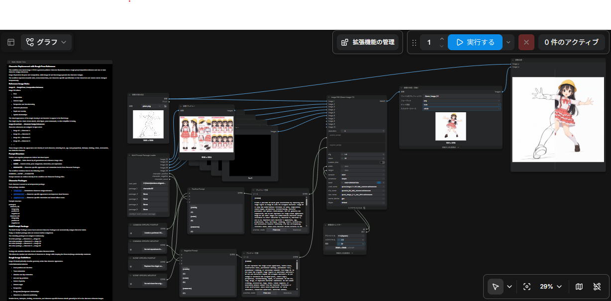

# Qwen Image Edit Character Replacement Workflow

## Build Scene Prompts ノード

各テンプレート変数を複数行テキストで入力し、全年齢向けのPositive／Negative Promptを生成できます。[テンプレートの説明](scene-prompt-builder.md) と [パッケージのインストール方法](../README.md) を参照してください。



## 概要

ComfyUI + Qwen Image Editを使用し、ラフ画像のポーズ・構図を維持しながら、キャラクターシートのデザインへ置き換えるワークフロー。

基本的な役割は以下。

- Image 01 = WHERE / HOW（ポーズ・構図）
- Image 02+ = WHO（キャラクターデザイン）
- SCENE = WHAT IS HAPPENING（動作・状況・表情）

## Reference Image

### Image 01: Rough Reference

Image 01はポーズ・構図の参照画像として使用する。

参照する情報:
- ポーズ・重心
- キャラクター配置
- カメラアングル・パース・foreshortening
- 前後関係・オーバーラップ
- キャラクター同士の位置・接触関係

顔、髪型、服装などのキャラクターデザインは継承しない。

棒人間、人体マネキン、手描きラフなどを使用できる。強いパースやforeshorteningが必要な場合はラフにも明確に反映する。

### Image 02+: Character Reference

Image 02以降はキャラクターデザインの参照画像。

| Reference | Character |
|---|---|
| Image 01 | Rough |
| Image 02 | Character A |
| Image 03 | Character B |
| Image 04 | Character C |
| ... | ... |

顔、年齢感、体格、髪型、服装、色、アクセサリーなどはCharacter Referenceを基準とする。

## Prompt Structure

Positive / Negativeともに以下の3層で管理する。

1. COMMON — 全生成共通のルール
2. SCENE — 人物割り当て、動作、状況、表情
3. CHARACTER — キャラクター固有の特徴・制約

結合順:

`COMMON → SCENE → CHARACTER`

同じ説明を複数の層に重複して記載しない。例外として、COMMONの全体的な参照ルールに加え、ローダーが各CHARACTER Positiveに短いidentity lockを自動付与する。

## Character Package

1キャラクターを1Packageとして管理する。

```text
<root>/
├─ character_01/
│  ├─ image.png
│  ├─ positive.txt
│  └─ negative.txt
├─ character_02/
│  ├─ image.png
│  ├─ positive.txt
│  └─ negative.txt
└─ ...
```

- `image.png` — Character Reference
- `positive.txt` — キャラクター固有の特徴
- `negative.txt` — キャラクター固有の禁止事項・既知の失敗対策

`positive.txt` / `negative.txt`にはCharacter A/B/Cなどの割り当てを記載しない。割り当てはLoad Character References (Up to 5)が行う。

## Load Character References (Up to 5)

選択されたPackageからCharacter ReferenceとPromptを読み込む。

`None`のスロットは除外し、有効なPackageを上から連続して割り当てる。

例:

```text
package_1 = character_01
package_2 = None
package_3 = character_07
package_4 = character_12
```

割り当て:

```text
character_01 → Character A → Image 02
character_07 → Character B → Image 03
character_12 → Character C → Image 04
```

Package Slot NumberとCharacter番号は一致しない。Image 01は常にRoughのため、1番目の有効PackageはImage 02から開始する。

### 出力とidentity lock

既存の出力順（image_02〜image_06、character_positive、character_negative、character_count）は維持し、末尾にSTRING出力 `character_mapping` を追加する。入力とパッケージのファイル構成は変更しない。

`character_mapping` は有効パッケージ順の対応一覧を返す。例:

```text
Character A = Image 02
Character B = Image 03
```

全スロット無効なら対応一覧とキャラ本文は空文字、character_countは0となる。未使用画像出力は従来どおり1×1の黒画像。

各Positiveブロックは次のように生成する:

```text
CHARACTER A — DESIGN SOURCE: IMAGE 02 ONLY

（positive.txtの本文）

IDENTITY LOCK: Use only the assigned reference for this character's design; do not borrow traits from other references.
```

Negativeの見出しと本文形式は従来どおり。各キャラで他の4枚を列挙する禁止文は追加しない。COMMON Negativeに全体のidentity mixing禁止を置き、negative.txtにはキャラ固有の失敗対策を書く。

COMMONには参照画像の役割・全体の混入禁止・画風、SCENEには今回の配置・動作・表情・視線・カメラ条件を置く。シーン固有の指示や固定A〜E、画像番号、identity lockはパッケージ本文に入れない。

## Prompt Assembly

ComfyUIの既存「テキスト整形」ノードでPositive / Negativeをそれぞれ結合する。ノードを増やさず、Positive側の未使用入力 values.d に character_mapping を接続する。

Positive:

```text
[COMMON]
{a}

[SCENE]
Character reference mapping:
{d}

{b}

[CHARACTER]
{c}
```

入力:

```text
a = COMMON
b = SCENE
c = character_positive
d = character_mapping
```

Negativeは既存の書式を維持する:

```text
[COMMON]
{a}

[SCENE]
{b}

[CHARACTER]
{c}
```

Negativeの a = COMMON Negative、b = SCENE Negative、c = character_negative。

[character-replacement-from-txt.json](../examples/workflows/character-replacement-from-txt.json) はこの接続に更新済み。パッケージ全体を配置してComfyUIを再起動し、JSONを読み込む。画像やモデル、参照データのパスは利用環境に合わせて設定する。既存ワークフローを手動更新する場合はローダーの出力を更新し、末尾の character_mapping をPositive整形の values.d に接続して上記書式へ変更する。

対応一覧はラフへの位置割り当てやSCENE本文を自動更新しない。パッケージを変更・無効化したらSCENE内の人物名と位置・動作の割り当ても確認する。character_countの接続は任意。

## Prompt Tuning

Promptは必要以上に長くせず、実際に発生した失敗に対して必要最小限の指示を追加する。

- 全シーンで発生する問題 → COMMON
- 特定シーンだけの問題 → SCENE
- 特定キャラクターだけの問題 → CHARACTER

Negative PromptもPositive Promptの反対語を列挙するのではなく、実際の失敗防止を中心に記述する。
